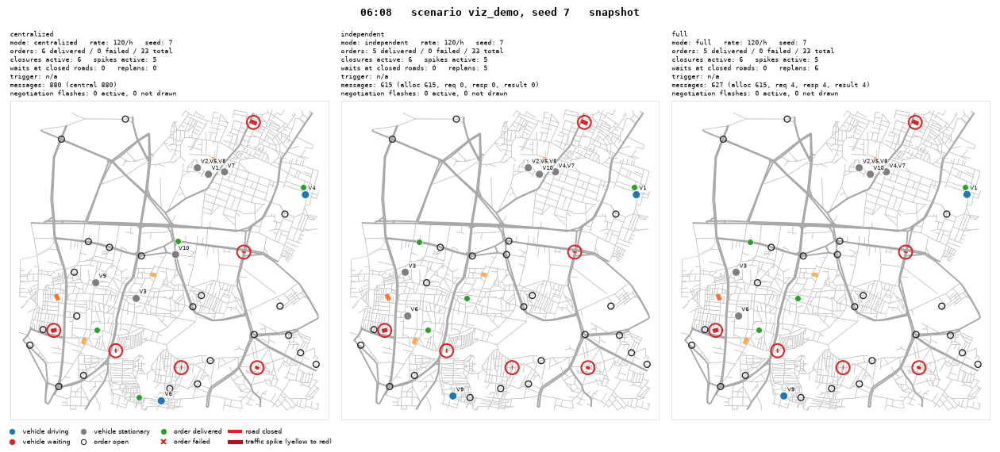

# Side-by-side replay, viz v2 (R2, Week 5)

`src/viz/multipane.py` plays two or three simulator logs (format: `docs/log_schema.md`)
next to each other on one shared clock, on the Secunderabad road map. Each pane is the
Week 4 replay (`src/viz/replay.py`, unchanged): at every frame time `t` each pane calls
`state_at(its own events, t, config, graph)` and draws with its own `ReplayRenderer`.
The new file adds the comparison checks, a richer HUD per pane, negotiation flashes and
playback keys.

## How to run (from the repo root)

```bash
# 1. Demo runs: same config, seed and rate in every condition (Week 7)
#    writes logs/pair_noreplan.jsonl, pair_independent.jsonl, pair_full.jsonl and, with
#    --centralized, pair_centralized.jsonl (stopped after 10 min: then no file)
python -m src.viz.demo_pair --centralized         # --rate 120 by default (stress setting)

# 2. Live window with playback keys
python -m src.viz.multipane \
    --logs logs/pair_centralized.jsonl logs/pair_independent.jsonl logs/pair_full.jsonl \
    --labels "centralized" "independent" "full" --config configs/viz_demo.yaml --show

# 3. Or a video (reports/replay/multipane_<run ids>.gif, .mp4 with ffmpeg) / one PNG
python -m src.viz.multipane \
    --logs logs/pair_centralized.jsonl logs/pair_independent.jsonl logs/pair_full.jsonl \
    --labels "centralized" "independent" "full" --config configs/viz_demo.yaml --end 07:00
python -m src.viz.multipane \
    --logs logs/pair_centralized.jsonl logs/pair_independent.jsonl logs/pair_full.jsonl \
    --labels "centralized" "independent" "full" --config configs/viz_demo.yaml \
    --snapshot-t 06:08:17 --png docs/multipane_example.png --png-dpi 75
```

If the centralized run does not finish in 10 minutes, use
`logs/pair_noreplan.jsonl` (label `no replanning`) as the first pane instead.

Options: `--step 30` (sim seconds per frame), `--fps 15`, `--dpi 80`, `--start` / `--end`
(HH:MM or seconds from midnight), `--out <path>`, `--layout row|column` (side by side, or
stacked), `--allow-mismatch` (see below). A third log is added with a third `--logs` path
and a third `--labels` string. Rendered files go to `reports/replay/` and are not
committed (except `docs/multipane_example.png`, Week 7 below).

## Playback keys (`--show`)

| key | action |
|-----|--------|
| space | pause / resume |
| `+` (or `=`) / `-` | faster / slower: 0.25x, 0.5x, 1x, 2x, 4x, 8x, 16x |
| right / left arrow | pause and step one frame forward / back |
| `r` | restart from the start time |

The current state and speed are printed in the header line, for example
`PAUSED  speed 2x (60 sim-s/frame)`. Speed changes how many sim seconds one frame
advances (`--step` x speed), not the timer interval. matplotlib's own bindings for the
arrow keys and `r` (back / forward / home view) are switched off in the window so they do
not clash. Offline rendering (GIF/MP4/PNG) has no keys: its speed is `--step` sim seconds
per frame at `--fps`, printed in the header.

`FuncAnimation` runs with `blit=False`, as in `replay.py` (the brief said "with blit as
replay.py does", but `replay.py` uses `blit=False`). Blitting only repaints the inside of
each axes; the HUDs and the clock sit outside them, so with blit they would smear. Every
frame is a full redraw, so the live window cannot reach 15 fps with two or three panes
(see the timings): it plays as fast as it can draw.

## Rules

### Same scenario and seed, or stop

All non-empty logs must have the same `scenario` and `seed` (from the log keys of the
first row). If they differ, the program stops with an error naming each log's scenario and
seed, before loading the map. `--allow-mismatch` renders them anyway, but prints a red
banner across the top of the figure ("logs are NOT from the same scenario and seed ...
NOT A COMPARISON") and a warning in the terminal, and the header then drops the scenario
and seed line. Different scenarios are never compared silently. `mode` and `run_id` are
expected to differ and are not checked; `rate` is not checked either (shown in each HUD).

### One clock

The shared clock runs over the union of the logs' time ranges (`time_range` of each
non-empty log: `sim_start`/`duration_seconds` if logged, else first/last `t`). If every
log is empty it falls back to the config's `start_time_s` and `duration_seconds`. A pane
whose log ended earlier keeps its last state and its HUD adds
`FINISHED: log ended at HH:MM, last state held` (Week 6).
The spike colour scale is the same in all panes (the largest `max_spike` / magnitude over
all logs), so equal colours mean equal multipliers.

### HUD per pane

The single-pane HUD of `replay.py` (`hud_text`) is hidden; each pane has its own:

```
<label>
mode: <from the log>   rate: <n>/h   seed: <n>
orders: d delivered / f failed / n total
closures active: a   spikes active: s
waits at closed roads: <blocked_wait rows up to t>   replans: <replan rows up to t>
trigger: on | off | n/a        <- latest trigger_toggle row up to t; n/a if none
messages: n/a (not logged)     <- or: messages: T (alloc a, req q, resp p, result r[, central c])
negotiation flashes: k active, u not drawn      <- only when messages are logged
```

"waits" counts rows, and the simulator writes one `blocked_wait` row every 60 s while a
vehicle stands at a closed road, so it measures waiting time in minutes summed over
vehicles, not the number of separate stops. "replans" counts R7's `replan` rows: one per
agent whose route changed, so one closure can add several.

### The n/a rule for messages

`message_counts_at(events, t)` counts the four types `allocation` (R4's contract-net),
`negotiation_request`, `negotiation_response`, `negotiation_result` (R5) one by one, and
R4's centralized rows `central_state_report` and `central_plan_broadcast` together as
`central`. Each row adds `replay.message_row_count` (`payload.get("count", 1)`), so the
total is always equal to `replay.messages_at(events, t)["total"]` (a test checks this for
centralized, full and mixed logs). Only rows with `t <= t_now` count. The four `alloc / req
/ resp / result` numbers are shown if the log has any of those rows, `central c` if it
has any `central_*` row. If the log has **no** message row at all (anywhere in the log),
the function returns `None` and the HUD shows `messages: n/a (not logged)`, because
showing `0` would claim that no messages were sent. In the Week 7 demo runs that is only
the no-replanning run. If the log has message rows but none yet at `t`, the HUD shows
`0`, which is then true.

## Negotiation event contract (Week 7: now in `docs/log_schema.md`)

R5's hook (`src/sim/coordination_hook.py`, mode full) and R4's contract-net
(`src/sim/dispatch.py`, independent/full) now write these rows; the payloads are defined in
`docs/log_schema.md` and match what the viewer reads:

| event | agent_id | payload (from `docs/log_schema.md`) |
|-------|----------|-------------------------------------|
| `allocation` | vehicle / `manager` | `{"phase", "recipient", "order_id", "sender"?, "cost"?}`, one row per message (no `count`, so 1) |
| `negotiation_request` | vehicle | `{"count": 1, "edge": [u, v, key]}` |
| `negotiation_response` | vehicle | `{"count": 1, "edge": [u, v, key]}` |
| `negotiation_result` | env | `{"count": m, "edge": [u, v, key], "vehicles": [ids], "winner", "price", "ttc", "actions"}` |

Flash rule (`flashes_at`): a `negotiation_result` row at `t0` is active while
`t0 <= t < t0 + 60` (sim seconds). It is drawn as an orange ring
1. at the midpoint of `payload.edge` if both nodes are on the map; else
2. at the current position of each vehicle in `payload.vehicles` that is on the map; else
3. not drawn, and counted in the HUD as `u not drawn`, so a missing position is visible
   instead of silently dropped.

`count` is how many messages one row stands for (D7: a result told to m vehicles is m
messages). R5's result rows always carry an on-map `edge`, so rule 1 applies.

## Measured performance

**Prediction (given before measuring, by Prudhvi (R2)):** "2x and 3x, so roughly 0.19 s and
0.29 s per frame, as it should scale linearly" (from the Week 4 single pane, 0.096 s).

**Measured** (one Windows 11 laptop, Python 3.14.5, matplotlib 3.11.2, no ffmpeg so GIF
via Pillow, `--dpi 80`, `--step 30`, 06:00-07:00 = 121 frames, the busy hour of the demo
pair; `time.perf_counter`, 5 runs each, median of the per-run seconds per frame):

| panes | logs | s/frame (median) | 5 runs | vs 1 pane | predicted |
|-------|------|------------------|--------|-----------|-----------|
| 1 (`replay.py`) | pair_independent | **0.105** | 0.105, 0.103, 0.105, 0.105, 0.105 | 1.00x | (0.096) |
| 2 | pair_noreplan + pair_independent | **0.153** | 0.156, 0.153, 0.152, 0.153, 0.156 | 1.46x | 0.19 (2x) |
| 3 | + pair_independent again, labelled `PLACEHOLDER: same log` | **0.221** | 0.223, 0.222, 0.220, 0.221, 0.221 | 2.10x | 0.29 (3x) |

The single pane was re-timed in the same session instead of using Week 4's 0.096 s
(different log, a busier hour, another day): 0.105 s.

**The prediction was wrong**: time grows with the number of panes, but less than
linearly (1.46x and 2.10x, not 2x and 3x). Each extra pane added about 0.05-0.07 s.

**Where the time goes** (medians per frame, from the same runs):

| | 2 panes | 3 panes |
|-|---------|---------|
| compute: `state_at` + counters + flashes, all panes | 3.1 ms (2%) | 4.3 ms (2%) |
| of which `state_at` alone (separate loop) | 1.4 ms | 2.0 ms |
| moving the artists (`set_offsets`, HUD text) | 0.8 ms | 1.1 ms |
| `grab_frame` (matplotlib draws the figure, copies pixels) | 111.9 ms (73%) | 156.9 ms (71%) |
| rest: Pillow writes the GIF when the file is closed | about 37 ms | about 59 ms |
| update + `canvas.draw()` only, no writer (separate loop) | 106.3 ms | 146.0 ms |

So almost all the time is matplotlib drawing (and then GIF encoding); `state_at`
rescanning the whole log every frame costs 1-2 ms and is not worth optimising. Why the
growth is less than linear was not measured. Two likely reasons, both unconfirmed: part
of each draw is per figure (one canvas, one clear, one pixel copy), not per pane, and
the figures differ in size (one pane is 8 x 9.8 in = 78 in², two panes 11.2 x 8.6 =
96 in², three 16.8 x 8.6 = 144 in²: 1.23x and 1.85x the pixels).

Consequence for `--show`: one frame of three panes takes about 0.15 s to draw, so the
window shows about 6-7 frames per second, not 15.

## Gaps

Week 5 gaps that are closed now (Week 7): the three real conditions exist (`run.py`'s
mode switch, R5's hook and R7's planner are connected; see "Week 7" below), message rows
are logged, and a vehicle waiting at a closed road follows a new route as soon as a
planner gives it one (`_drive_route` in `src/sim/environment.py` leaves the wait loop when
`remaining_route` is replaced). Still open:

- **The demo runs are not the experiment.** `src/viz/demo_pair.py` runs
  `configs/viz_demo.yaml` (10 vehicles, 30 orders, seed 7) at 120 disruptions per hour, a
  stress setting picked so the panes show something. The `rate` also covers `new_order`
  events (341 disruptions + 132 new orders in 4 h). Condition (a) is labelled
  `no_replanning`, which is not one of the plan's modes; it is the plain R1 simulator.
  Results from them are not experiment results.
- **Same seed, but the disruptions may differ.** The closure guard (D11) depends on where
  vehicles still need to go, which the planners change, so the random stream can drift
  apart between runs. In the Week 7 runs it did not (all 4 logs share 341 of 341 disruption
  rows); `demo_pair.py` prints this check every run.
- **Dynamic orders are counted, not served.** `new_order` events (D11) have no node and
  create no order (TODO(R3) in `src/sim/events.py`), so they only raise "total" in the HUD
  (33 = 30 + 3 by 06:08:17).
- **The window cannot keep up with `--fps`** because every frame is a full redraw
  (`blit=False`, see above).
- Everything listed in `docs/replay_viz.md` (straight-line motion, order locations from
  the config) still applies to each pane.

## Week 6: hardening (performance, edge cases, screenshots)

### Setup

20 vehicles, 60 orders: `python -m src.viz.demo_scenario --vehicles 20 --orders 60 --seed 7
--out logs/viz_demo20.yaml`, then `python -m src.viz.demo_pair --config logs/viz_demo20.yaml
--prefix pair20` (`--prefix` is new; default `pair`, so the Week 5 files are unchanged).
Result (a stress demo, not an experiment): no replanning 60 delivered, 0 failed, 83
`blocked_wait`, 0 replans, last order 06:51:55; independent 60 delivered, 0 failed, 0
`blocked_wait`, 730 replans, last order 06:36:17; 341 of 341 disruption rows identical.
(These are the Week 6 logs: `demo_pair.py` then built the independent run itself, R7's
planner on `run.py`'s first-vehicle route assignment. Since Week 7 it runs independent and
full through `src/sim/run.py` with R4's contract-net, so a rerun gives other numbers.)

Timing method as in Week 5: GIF via Pillow (no ffmpeg), `--dpi 80`, `--step 30`,
06:00-07:00 = 121 frames (the busiest hour: 4,417 of 4,778 and 4,932 of 5,294 rows), 5 runs,
median of seconds per frame, `time.perf_counter`, one Windows 11 laptop. 1 pane = the
`replay.py` figure (8 x 9.8 in) on `pair20_independent`; 2 panes = `pair20_noreplan` +
`pair20_independent`; 3 panes adds `pair20_independent` again, labelled
`PLACEHOLDER: same log`.

### What changed

1. **Roads drawn once** (`PaneRenderer`, a subclass of `ReplayRenderer`; `replay.py` is not
   changed). The two road `LineCollection`s (6,056 segments, 679 of them major roads) are
   drawn once into an RGBA image at the pane's real pixel size and output dpi, shown with
   `imshow` at zorder 1 and the same axes limits and aspect, and the original collections
   are hidden. The image is widened to whole output pixels so image pixel i is output
   pixel `px0 + i` (no resampling blur). It is rebuilt only when the dpi or the figure
   size changes. `--no-prerender` switches back to the Week 5 drawing.
2. **Figure height fitted to the map** (row layout). Week 5 used a fixed 8.6 in height;
   `set_aspect` then shrank each map box (0.707 to 0.626 of the height) and left empty
   bands above the HUD and below the legend. The height is now: 1.7 in on top (clock + a
   9-line HUD; + 0.65 in for the mismatch banner) + map height + 0.55 in for the legend.
   The column layout is not changed.
3. Edge cases (below), `--snapshot-times`, `--png-dpi`, and `--config` became optional.

**Same picture?** The same 06:28 snapshot (pair20) was rendered with and without
pre-rendering and compared pixel by pixel:

| figure | dpi | size (px) | largest difference (0-255) | where (x, y from top) | pixels that differ |
|--------|-----|-----------|----------------------------|-----------------------|--------------------|
| 2 panes | 80 | 896 x 610 | 1 | (305, 197), inside the left map | 3 of 546,560 |
| 2 panes | 100 | 1120 x 763 | 0 | - | 0 |
| 3 panes | 80 | 1344 x 608 | 1 | (321, 197), inside the left map | 8 of 817,152 |
| 3 panes | 100 | 1680 x 760 | 1 | (1480, 198), inside the right map | 7 of 1,276,800 |

So the difference is at most 1 level in at most 8 pixels: not visible. A test checks
`<= 1` on a small graph.

**Smaller figure:** 2 panes 11.2 x 8.6 in (96.3 in²) to 11.2 x 7.64 in (85.5 in², -11.2%);
3 panes 16.8 x 8.6 in (144.5 in²) to 16.8 x 7.60 in (127.7 in², -11.6%). The empty band
between the clock and the HUD in the 2-pane snapshot went from 102 px (11.9% of the
height) to 38 px (4.9%); what is left is room for the two extra HUD lines a pane gets
when messages are logged or its log has finished.

### Prediction vs measured

**Prediction (given before measuring, by Prudhvi (R2)):** "it would drop by 1.5 to 2
times as the other objects still need to be shown", that is 0.11-0.15 s per frame for 3
panes ("about half").

| panes | Week 5 code (s/frame) | fitted layout, roads redrawn (`--no-prerender`) | fitted layout + roads pre-rendered | change vs Week 5 code |
|-------|----------------------|------------------------------------------------|-----------------------------------|----------------------|
| 1 (`replay.py` figure) | **0.109** (0.109, 0.110, 0.110, 0.109, 0.109) | (layout not changed) | **0.111** (0.111, 0.111, 0.110, 0.112, 0.112) | +2% (no gain) |
| 2 | **0.165** (0.166, 0.165, 0.161, 0.163, 0.165) | **0.160** (0.160, 0.159, 0.157, 0.160, 0.159) | **0.150** (0.150, 0.151, 0.150, 0.149, 0.149) | -9% |
| 3 | **0.237** (0.237, 0.236, 0.235, 0.237, 0.241) | **0.226** (0.225, 0.227, 0.224, 0.226, 0.226) | **0.207** (0.207, 0.206, 0.208, 0.207, 0.206) | -12.5% |

**The prediction was wrong.** 3 panes went from 0.237 to 0.207 s (1.14x faster), not to
0.11-0.15 s. Of the 12.5%, about 4.5 points come from the smaller figure and 8 points from
the pre-rendered roads. The right bucket was "a little (under 20%)". At 20 vehicles the
Week 5 code is 4-7% slower than at 10 vehicles (0.105 / 0.153 / 0.221 s).

**Why so little** (cProfile of 41 frames, 3 panes, dpi 80; the profiler inflates absolute
times, the shares are what matter): one frame calls `Text.draw` 96 times (20 vehicle labels
with a box per pane, 3 HUDs, the legend, the clock), about 134 of 222 ms, roughly 60%.
The roads cost about 60 ms as line collections, and the image that replaces them still
costs about 27 ms, because matplotlib resamples an `imshow` image on every draw even at
1:1. So pre-rendering saves about 30 ms of a ~220 ms frame. The roads were never the main
cost; text is.

### Pre-rendering or a smaller picture? (3 panes, fitted layout, s/frame, 5 runs median)

| | dpi 80 (1344 x 608 px) | dpi 60 (1008 x 456 px) |
|-|------------------------|------------------------|
| roads redrawn | 0.226 | 0.200 (-11%) |
| roads pre-rendered | 0.207 (-8%) | **0.173** (-23%) |

A smaller picture helps slightly more than pre-rendering (-11% vs -8%), and the two
together give -23%. dpi 60 has 44% fewer pixels but saves only 11%: the drawing part
(`grab_frame`) barely changed (166 to 162 ms); most of the saving is GIF encoding. So the
Week 5 guess "time roughly proportional to figure area" holds for GIF encoding, not for
drawing, which is dominated by per-text costs. Text readability at dpi 60 was not
checked by eye.

### Live window (`--show`), 3 panes, 20 vehicles

Measured in a real TkAgg window (FuncAnimation at `--fps 30`, 80 frames, each
`canvas.draw` timed, first 5 frames skipped). This laptop's screen is scaled to 200%, so
the window draws at dpi 200 on a 3204 x 1520 px canvas (about 6x the pixels of the 80 dpi
GIF):

| | `canvas.draw` median | frame to frame | fps |
|-|----------------------|----------------|-----|
| roads redrawn | 217.5 ms (199.5-235.5) | 234.0 ms | **4.3** |
| roads pre-rendered | 321.2 ms (301.4-341.4) | 338.4 ms | 3.0 |

Pre-rendering made the window **slower**: at this pixel count, resampling the
1020 x 1022 px road image cost about 52 ms per pane per frame, more than drawing the lines.
The road image was built 3 times at start-up (dpi 200 / 100 while the window settled, the
width shrank to 16.02 in to fit the screen), not every frame. So `--show` does not
pre-render (only GIF/MP4/PNG do). Not measured on a 100%-scaled screen.

**Can matplotlib reach the plan's ~30 fps (0.033 s per frame)? No.** The best offline
draw measured here (dpi 60, pre-rendered) is 0.133 s for `grab_frame` alone, 4x over
budget, and drawing the text alone took about 100 ms per frame under the profiler. What would work (not implemented): the video
(GIF, or MP4 with ffmpeg) as the main demo asset, since it plays at its own fps whatever
the draw time; a smaller figure or fewer labels for the live view; a pygame (or similar)
viewer later if a live 30 fps view is really needed.

### Edge cases

Each has a headless test in `tests/test_multipane.py` (`test_edge_*`). "Week 5 code" is
the same test run against the committed `multipane.py` (HEAD) in a scratch copy.

| case | Week 5 code | now |
|------|-------------|-----|
| empty log file | passed: the pane says "empty log: nothing to replay" | unchanged |
| log with only `sim_start` and `sim_complete` | passed: "short log: only 2 event(s)", vehicles grey at their depots | unchanged |
| one pane ends earlier | **failed**: HUD said "(this log ended at 06:01)" without "finished", and the state kept moving: a vehicle waiting at the end turned grey 60 s later | pane holds its state at its log's end; HUD `FINISHED: log ended at HH:MM, last state held` |
| `--start` after `--end`, or outside the logs' range | **failed**: no check (`check_times` did not exist; from reading `frame_times`, start > end gives 1 frame and an out-of-range time renders frames, both silently) | `error: --start 06:08 is after --end 06:02`, or `... is outside the logs' time range: the logs run 06:00-06:10 (...)`, before the map is loaded; also for snapshot times |
| 150 closures + 150 spikes at once | passed (2 panes, test grid: 0.127 s per frame) | real map, 3 panes, 150 + 150 injected at 06:20 (HUD 165 / 161 active with the log's own): 0.165 s per frame pre-rendered, 0.183 s redrawn (draw + pixel copy, no GIF); a normal 06:20 frame is 0.151 s |
| all 20 vehicles on one node | **failed**: one 70-character label `V1,V2,...,V20` | wrapped, 5 ids per line (4 lines) |
| config missing | `--config` was required (usage error); a wrong path crashed with a `FileNotFoundError` traceback | `--config` optional: default map, a warning in the terminal, each HUD says `config: none (start positions and open orders unknown)`; vehicles appear only once they move, open orders are not drawn, delivered orders only if their row has a node. A wrong path: `error: config not found: <path>` |
| a bad JSON line | **failed** (not clean): the line number was in an uncaught `LogFormatError` traceback | `error: <path>, line 3: bad JSON (...)`, exit 1 |
| one log or four logs | **failed**: a message without usage, exit 1 | argparse usage + `--logs: need 2 or 3 logs, got 1`, exit 2 |

### Screenshots

`--snapshot-times 06:10 06:20 06:28 --png reports/replay/pair20.png` writes
`pair20_0610.png`, `pair20_0620.png`, `pair20_0628.png` (316-326 KB at the default
`--png-dpi 100`; not committed) from one figure, in 0.77 s for all three.
In Week 6 `docs/multipane_example.png` was the 10-vehicle pair at 06:28 with `--png-dpi 90`
(1008 x 687 px, 277 KB; at dpi 100 it was 319 KB, over the 300 KB limit). Week 7 replaced
it with the three real conditions (below).

Looked at (by Claude Code, in the session): the clock, both HUDs and the legend are
readable; the 20-vehicle 06:28 frame shows the wrapped label `V1,V7,V10,V13,V16` / `V19`.
At 06:28 the left pane has V6 and V8, V9, V12, V15, V18 red (waiting), 34 waits, 0 replans;
the right pane 0 waits, 690 replans, V3, V8, V9 and V12 driving.

### Gaps

- **Pre-rendering is a small win**: -8% (3 panes, dpi 80), none for 1 pane (+2%), and a
  loss in the live window on a 200%-scaled screen, where it is switched off. The real cost
  is text (about 60% of a frame); that was not changed.
- **The live window reaches 3-4 fps, not 30.** Not solvable inside matplotlib's full redraw.
- **Labels of nearby vehicles overlap.** Only vehicles on the same spot share a label. At
  06:10 (pair20) "V5" is half hidden behind V20's dot (left pane) and V7 / V1 / V18
  overlap (right pane). There is no label collision avoidance and no test for it.
- The pixel check is "at most 1 level in at most 8 pixels", not exactly equal.
- The column layout still uses fixed heights (not fitted).
- dpi 60 readability and the live window on a 100%-scaled screen were not checked.
- The 150 + 150 case uses disruptions injected into a real log, not simulator output.
- One laptop, one session. The Week 5 and Week 6 timings above used a copy of the
  independent log as the third pane (labelled `PLACEHOLDER: same log`), because the three
  real conditions did not exist yet; they were not re-timed with the Week 7 logs.

## Week 7: three real conditions

`python -m src.viz.demo_pair --centralized` (default config `configs/viz_demo.yaml`, seed 7,
120/h), output of the run in this session:

| run | mode in the log | delivered | failed | `blocked_wait` | `replan` | last order resolved | wall time |
|-----|-----------------|-----------|--------|----------------|----------|---------------------|-----------|
| `pair_noreplan` | no_replanning | 30 | 0 | 23 | 0 | 06:36:53 | 4.5 s |
| `pair_independent` | independent | 30 | 0 | 0 | 5 | 07:00:55 | 3.5 s |
| `pair_full` | full | 30 | 0 | 0 | 6 | 07:00:55 | 4.2 s |
| `pair_centralized` | centralized | 30 | 0 | 0 | 0 | 06:58:42 | 301.3 s |

The centralized run finished inside the 10-minute limit. All 4 logs share 341 of 341
disruption rows, and `python -m src.sim.check_log` says `ok` for each. The replans in
independent and full are all `new_order` (contract-net awards) plus one
`negotiation_yield` in full; none is triggered by a closure in these runs, so these
panes show no closure detour. Messages in the whole run: full 627 (allocation 615,
negotiation 12 = 2 auctions x 3 x 2 vehicles, equal to `replan_summary.negotiation_messages`),
independent 615, centralized 10,060 `central_*` rows (equal to the sum of its
`allocation_complete.messages`).



*`docs/multipane_example.png`: `pair_centralized`, `pair_independent`, `pair_full` at
06:08:17, 30 s after a closure started at 06:07:47 (road 12020059935 -> 2855064950); 6
closures and 5 spikes active in every pane, 2 vehicles driving in each. Labels are the
log's own modes. The seed check passed (same scenario `viz_demo`, seed 7; no
`--allow-mismatch`). `--png-dpi 75`: 1260 x 570 px, 289 KB (dpi 90 was 381 KB, over the
300 KB limit).*

Message lines in the snapshot: centralized `messages: 880 (central 880)`, independent
`messages: 615 (alloc 615, req 0, resp 0, result 0)`, full
`messages: 627 (alloc 615, req 4, resp 4, result 4)`. Each was checked against
`replay.messages_at` on the same log at 06:08:17, which gives 880 (central), 615
(allocation) and 627 (allocation 615 + negotiation 12).
