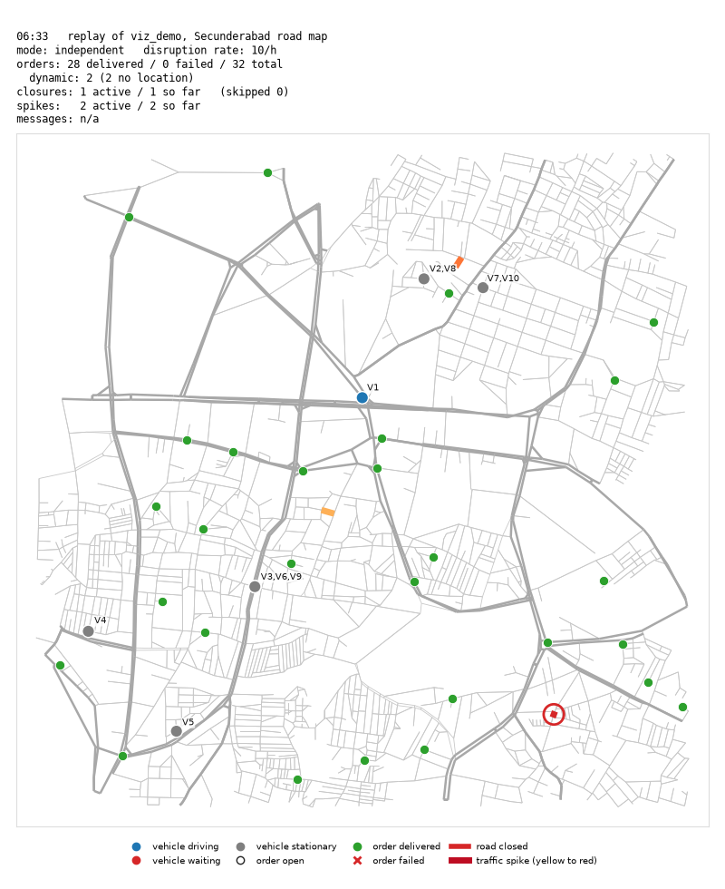

# Replay visualization v1 (R2, Week 4)

`src/viz/replay.py` replays one simulator JSONL log (format: `docs/log_schema.md`)
on the real Secunderabad road graph, as a GIF/MP4 or a single PNG snapshot.



*Snapshot of the `viz_demo` run at 06:33: one closure active (red ring, bottom right),
two traffic spikes (orange segments), V1 driving, the other vehicles stopped.*

## How to run (from the repo root)

```bash
# 1. Build the 10-vehicle demo config (deterministic, writes configs/viz_demo.yaml)
python -m src.viz.demo_scenario --vehicles 10 --orders 30 --seed 7

# 2. Run the simulator (writes logs/viz_demo.jsonl; mode from the config, "independent":
#    R4's contract-net + R7's planner since Weeks 5-6, so not the Week 4 log measured below)
python -m src.sim.run --config configs/viz_demo.yaml

# 3. Render the replay (reports/replay/viz_demo.gif, or .mp4 if ffmpeg is on PATH)
#    and/or a snapshot PNG at a given time
python -m src.viz.replay --log logs/viz_demo.jsonl --config configs/viz_demo.yaml
python -m src.viz.replay --log logs/viz_demo.jsonl --config configs/viz_demo.yaml \
    --snapshot-t 06:33 --png docs/replay_example.png
```

Other options: `--step 30` (sim seconds per frame), `--fps 15`, `--dpi 80`,
`--start 06:00 --end 07:00` (HH:MM or seconds from midnight), `--out <path>`,
`--show` (live window instead of a file). `--snapshot-t` without `--out` renders only
the PNG. Rendered files go to `reports/replay/` and are not committed.

## What the colours mean

| Mark | Meaning |
|------|---------|
| light grey lines (thicker for motorway/trunk/primary/secondary) | road network |
| blue dot | vehicle **driving** |
| red dot | vehicle **waiting** in front of a closed road (a `blocked_wait` row in the last 60 s; with R7's planner attached a vehicle reroutes instead, so this is mostly seen in no-planner runs) |
| grey dot | vehicle **stationary** (at a node: serving an order, waiting for a time window, or done) |
| small label next to a dot | vehicle id; vehicles at the same spot share one label, e.g. `V3,V6,V9` |
| hollow black circle | order **open** (released, not yet delivered or failed) |
| filled green circle | order **delivered** |
| red x | order **failed** |
| thick red line + red ring | road **closed** (the ring keeps short edges visible) |
| yellow to red line | traffic **spike**, colour = multiplier from 1.0 (yellow) to `max_spike` (red, default 3.0) |

The HUD above the map shows the sim clock (HH:MM, from `t` in seconds from midnight), run
id, mode, disruption rate (all from the log keys), orders delivered / failed / total,
dynamic orders and how many have no location, closures and spikes active / so far,
closures skipped by the guard, and the messages sent so far (below). The legend sits below
the map, so neither covers anything on it.

### Messages line (Week 7)

`messages_at(events, t)` sums every message row with `t_row <= t`, by group:

| group | rows (who logs them) | messages per row |
|-------|----------------------|------------------|
| negotiation | `negotiation_request`, `negotiation_response`, `negotiation_result` (R5's hook, mode full, `src/sim/coordination_hook.py`) | `payload["count"]` (D7: 1 per request / response, m for a result told to m vehicles, so 3m per auction) |
| allocation | `allocation` (R4's contract-net, independent/full, `src/sim/dispatch.py`) | 1 (one row per announcement / bid / award) |
| central | `central_state_report`, `central_plan_broadcast` (R4's centralized re-solve, `src/allocation/central_vrp.py`) | 1 (one report and one broadcast per vehicle per re-solve, `CentralResult.messages = 2 x vehicles`) |

`allocation_complete` also carries a `messages` total, but only repeats the rows above,
so it is not counted again. The HUD shows `messages: N so far (negotiation a, allocation b,
central c)`, listing only the groups that occur anywhere in the log; before the first
message row this is a true `0`. A log with none of these rows (for example
`demo_pair.py`'s no-replanning run) shows `messages: not logged`, never `0`.

## State rules (`state_at(events, t, config, graph)`)

`state_at` returns plain data (no matplotlib) so the Week 5 three-pane view can reuse it.
Only events with `event.t <= t` count.

- **Vehicle position.** After an `edge_enter [u, v]` at `t0` with `expected_duration d`,
  the vehicle moves in a straight line from `u` to `v`: fraction `(t - t0) / d`, clamped
  to [0, 1]. After `edge_exit` it sits at `payload.node`. Before its first event it is at
  `current_node` (else `depot_node`) from the config; with no config it is not shown.
- **Vehicle state.** `driving` between `edge_enter` and `edge_exit`; `waiting` if a
  `blocked_wait` happened in the last 60 s and there has been no `edge_enter` since
  (the vehicle is drawn at the start node of the blocked edge); otherwise `stationary`.
- **Closures and spikes** are active while `disruption.t <= t < payload.expiry`.
  A spike carries its edge and `magnitude`.
- **Orders.** Config orders are `not_released` while `t < release_time` (absolute
  seconds, as the simulator compares it with `tw_start`) and are not drawn then; then
  `open`; then `delivered` / `failed` from `order_delivered` / `order_failed` events.
  Orders that appear only in the log take their node from those payloads. `new_order`
  events are counted; they are drawn only if the payload has a `node` key (none do yet).
- **Counters.** delivered, failed, total known orders (config orders + dynamic orders
  seen so far + any other order ids in the log so far), new_orders, undrawn_orders,
  closures active / total so far, spikes active / total so far, closure_skipped so far.

## Measured performance (10-vehicle, 4 h demo, Week 4 log)

Measured in Week 4 (before R4's contract-net and R7's planner were in `run.py`) on this laptop (Windows 11, Python 3.14, matplotlib 3.11, no ffmpeg, so GIF):

| | |
|-|-|
| log | `logs/viz_demo.jsonl`, 2258 events (1095 edge_enter, 31 disruptions: 17 closures and 14 spikes, 5 new_order, 30 delivered, 0 failed) |
| frames | 481 (06:00 to 10:00, `--step 30`) |
| render time | 46.4 s, **0.096 s per frame** (two earlier runs: 47.7 s and 45.6 s) |
| GIF | 1.1 MB at `--dpi 80` (640 x 784 px) |
| snapshot PNG | about 0.2 s, 225 KB at dpi 100 |

`state_at` rescans the event list on every frame. At 2258 events that is cheap; the
time is mostly matplotlib drawing and the GIF writer.

Pillow merges identical consecutive frames into one with a longer duration (once the
vehicles stop, two 30 s frames in the same minute look the same), so the GIF holds 308
frames, not 481. GIF frame times are whole centiseconds, so 1/15 s becomes 60 ms and the
GIF plays in 30.6 s, not 32.1 s (about 5% fast). An MP4 (ffmpeg) does not have this.

## Gaps and assumptions

- **Straight-line motion.** Vehicles and closed/spiked roads are drawn as straight lines
  between node coordinates; the curved OSM road geometry is not used. The base map is
  drawn the same way so vehicles stay on the drawn roads.
- **Dynamic orders are not drawn.** `new_order` payloads have only `order_id` and
  `release_time`, no node (the simulator does not create real orders yet, TODO(R3) in
  `src/sim/events.py`). They are counted in the HUD ("dynamic: n (n no location)").
  If a later log adds `payload.node`, the replay draws them with no code change.
- **Messages are counted as logged.** The HUD trusts each row's `payload["count"]` and
  R4's one-row-per-message rule; it does not re-derive D7 counts. In the Week 7 demo runs
  the totals equal R5's `replan_summary.negotiation_messages` and the sum of R4's
  `allocation_complete.messages` (`docs/multipane_viz.md`, Week 7).
- **Order locations come from the config, not the log.** The log does not say where an
  order is until it is delivered or failed, so open orders need `--config`. Without a
  config only finished orders whose row has a `node` (and vehicles once they move) are
  drawn. R4's centralized runner logs `order_delivered` with `order_id` only (no `node`,
  `src/allocation/sim_runner.py`), so without `--config` a centralized replay draws none
  of its delivered orders.
- **Vehicle starts come from the config.** Without `--config` a vehicle appears at its
  first event.
- **One log per figure.** One log, one map; `src/viz/multipane.py` puts 2-3 logs side by
  side, and `src/viz/report_figures.py` draws two times of one log next to each other.
  `ReplayRenderer(ax, graph)` takes any matplotlib axes.
- **"Waiting" needs a `blocked_wait` row.** The simulator writes one only while a vehicle
  stands at a closed road. With R7's planner attached (independent/full) a vehicle
  reroutes when a closure hits its route, and a vehicle already waiting follows the new
  route at once (`_drive_route` in `src/sim/environment.py`); in the Week 7 demo runs
  (`src/viz/demo_pair.py`, 120/h) independent, full and centralized have 0 `blocked_wait`
  rows and the no-replanning run has 23. In the Week 4 log (no planner) the closure guard
  never closed a road a vehicle still needed, so there were none either.
- **Most motion is early.** In the Week 4 log every vehicle finished its route by about
  06:41; in the Week 7 demo runs the last order is resolved between 06:36:53
  (no replanning) and 07:00:55 (independent, full). After that the replay shows only
  disruptions starting and ending; `--end 07:15` gives a shorter video of the busy part.
- **Which vehicle serves an order.** In independent/full, `run.py` hands every order out
  by R4's contract-net (`allocation: contract_net`, the default) and the hand-written
  routes in `configs/viz_demo.yaml` are not used (`src/sim/dispatch.py`, `setup`). Only
  `allocation: route` and `demo_pair.py`'s no-replanning run use `assign_orders`: the
  *first* vehicle whose route passes the order's node, which can differ from the vehicle
  `demo_scenario.py` planned.
- **Waiting window.** "Within the last 60 s" is inclusive (`t - t_wait <= 60`), because
  the simulator logs `blocked_wait` every 60 s and `t` is rounded to 2 decimals.
- **"total" for disruptions** in the HUD means "so far" (up to the current frame), not
  the whole run.

## Report figures (Week 7)

`python -m src.viz.report_figures` writes three PNGs to `reports/figures/` in about 22 s
(three runs in this session: 22.0, 22.2, 22.9 s, including two simulator runs):

| figure | content |
|--------|---------|
| `F_region.png` | road network (drawn by `ReplayRenderer`, so it looks like the replays) with the 3 depots and the order nodes of `configs/scenarios/medium_hotspot_s3.yaml`: 200 orders on 181 nodes, 146 released at 06:00 (blue), 54 later (orange, nodes with no 06:00 order); 1 km scale bar |
| `F_routes.png` | 4 A* routes from `src/search/astar.py` with `make_heuristic`; node pairs from `plot_route.far_apart_pair` with seeds 42, 43, 44, 45; each route is numbered at both ends, and the legend gives km (edge key 0, as in `plot_route.py`), free-flow minutes and nodes expanded A* vs Dijkstra. All 4 have the same cost as Dijkstra |
| `F_closure.png` | two replay snapshots (`ReplayRenderer` + `state_at`) of one real run, zoomed on a closure: before it and while it is active |

**How the closure run is chosen.** `small_hotspot_s0`, `s1`, ..., `s9` (each file's own
seed equals its suffix), mode independent, 20 disruptions per hour (the highest D11 rate),
are run in that order through `src.sim.run.run_from_config` into a temporary directory;
the first log with a `replan` row whose `trigger` is `closure` is used. The closure is the
`disruption` row on the same `(u, v)` that is active at the replan time. The "before"
snapshot is 60 s before the closure starts. The "active" snapshot is 30 s after the
replanning vehicle's first `edge_enter` out of the closed road's start node (where it
turns away from it), or 120 s after the replan if it never gets there while the
closure lasts. The right panel also draws the edges that vehicle entered from its replan
to that time (its `edge_enter` rows) and marks it with a dashed ring.

In this session the search stopped at the second seed and printed (the same text is the
figure's caption):

```
Run: scenario small_hotspot (small_hotspot_s1.yaml), seed 1, rate 20/h, mode independent; the first of seeds 0-9 whose log has a replan row with trigger "closure".
Road 364666844->3205568901 closed at 07:05:23 for 27.3 min; V08 replanned at 07:05:23. At 07:14:17 it left node 364666844 on road 364666844->364666849, not on the closed road.
Left: 07:04:23, before the closure. Right: 07:14:47, closure active.
```

`small_hotspot_s0` had 20 closures and no closure-triggered replan. V08 replanned while
standing at a stop (stationary in the 07:04:23 snapshot; its next `edge_enter` is at
07:13:21, right after its `order_delivered` row), so it reaches the turn about 9 minutes
after the replan.

**Deterministic.** No random numbers of its own; the pairs use `far_apart_pair`'s fixed
numpy seed and the runs the simulator's seeded generator. PNGs are saved without the
matplotlib version in their metadata. Three runs in this session (no `PYTHONHASHSEED`,
`PYTHONHASHSEED=1`, `PYTHONHASHSEED=2`) gave byte-identical PNGs (same MD5 for all three
files) and the same printed text apart from timings. R6's predictor and traffic model were
loaded in these runs (`World.from_defaults` found them on this machine); on a machine
without them the runs use free-flow times and the closure run, route times and figures can
differ.

Gaps: `F_closure.png`'s HUD clocks show HH:MM (the caption has the seconds); the edge
lengths in `F_routes.png` use parallel edge 0, as `plot_route.py` does, not necessarily the
edge A* chose; the zoom shows a fixed 1.5 km minimum window around the closure and the
vehicle, so other vehicles may be outside it.
