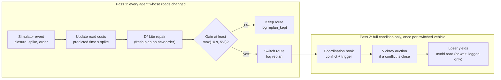
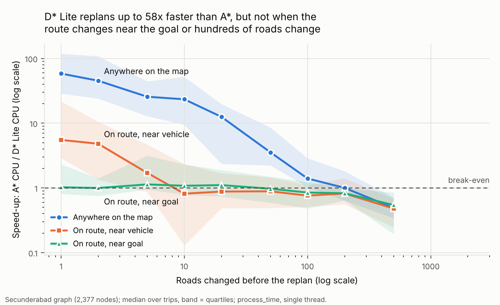
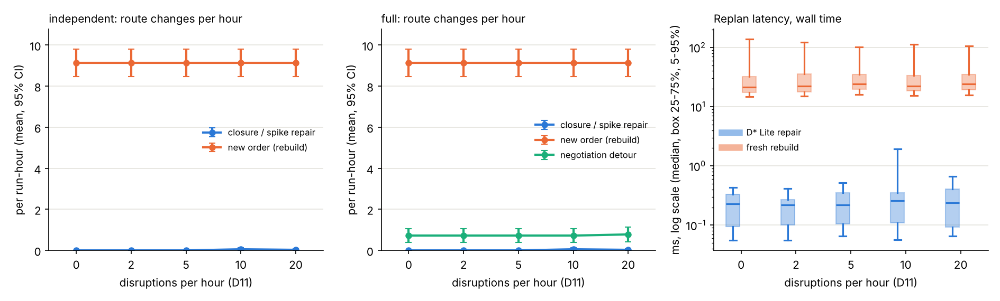

# R7 report sections: Dynamic Replanning with D* Lite (draft for R8 to merge)

Every number below comes from a committed file, script or test, named in brackets. The section covers
the replanning component (R7): the incremental search algorithm, how agents use it inside the
simulator, the rules that keep replanning stable, and what was measured. The main sweep is R8's and is
not described here.

---

## Course concepts (one row of the table)

| Concept | Where in the system | What it does in the experiments |
|---|---|---|
| Incremental heuristic search (D* Lite, an extension of A*) | `src/search/dstar_lite.py`, `src/search/multi_stop.py`, `src/search/sim_replanner.py`, `src/sim/agent_planner.py` (R7) | In the independent and full conditions every vehicle repairs its own route with D* Lite when a road closes, slows or must be avoided after an auction, instead of searching again from scratch. |

## Summary

Each vehicle replans its own route with D* Lite when the road network changes; repairing a route takes
about 0.2 ms against about 22 ms for a fresh plan.

- **Repair is fast.** In a 90-run pilot, the median D* Lite repair took 0.22-0.25 ms (wall time), while
  a full rebuild for a new order took 21-25 ms [`reports/replan_pilot_summary.csv`].
- **Repair beats rerunning A\* when few roads change.** On the Secunderabad graph, D* Lite replans up to
  58x faster than A* after one change off the route. The advantage disappears for changes near the
  goal and when hundreds of roads change at once [`reports/dstar_benchmark.csv`, figure F3].
- **Hysteresis halves route switches at no cost.** Requiring a gain of at least max(10 s, 5%) before
  switching cut route switches by about half, with identical deliveries [`docs/DECISIONS.md`, D12].
- **Cut-off stops are handled without losing reachable ones.** A bug that dropped about 115 reachable
  stops after one closure was found by the pilot and fixed: a run that failed 122 orders now fails none
  [`tests/test_agent_planner_w5.py::test_real_scenario_that_crashed_the_simulator`].

## Related work (about three sentences)

D* Lite (Koenig and Likhachev, 2002) is an incremental version of A* (Hart, Nilsson and Raphael, 1968)
for agents that move while edge costs change; it builds on Lifelong Planning A* (Koenig, Likhachev and
Furcy, 2004), which reuses earlier search results instead of searching from scratch. It is the
standard choice for replanning on a known graph whose costs change, as in our road network with
closures and traffic spikes. Our contribution is not a new algorithm but its use per vehicle inside a
multi-agent delivery simulator, with measurements of when repair pays off.

References:
1. S. Koenig and M. Likhachev. D* Lite. In *Proceedings of the 18th AAAI Conference on Artificial
   Intelligence (AAAI '02)*, pp. 476-483, 2002.
2. S. Koenig, M. Likhachev and D. Furcy. Lifelong Planning A*. *Artificial Intelligence*, 155(1-2),
   2004.
3. P. E. Hart, N. J. Nilsson and B. Raphael. A Formal Basis for the Heuristic Determination of Minimum
   Cost Paths. *IEEE Transactions on Systems Science and Cybernetics*, 4(2):100-107, 1968.

---

## Method

### 1. D* Lite: incremental search

D* Lite repairs a shortest path after edge costs change, reprocessing only the nodes whose distances
changed.

**Why not rerun A\*.** A vehicle on a 30-minute trip sees many small changes: a road closes, a traffic
spike slows a segment, the vehicle advances one node. Rerunning A* after each change repeats work that
is still valid. D* Lite keeps that work.

**How it works.** D* Lite searches backwards, from the goal to the vehicle, so the vehicle's movement
only changes the start node. Each node keeps two values:

- g(s): the current estimate of the cost from s to the goal;
- rhs(s): a one-step lookahead, the minimum over successors s' of c(s, s') + g(s').

A node is consistent when g(s) = rhs(s). When a road's cost changes, only the nodes at its ends can
become inconsistent. They go on a priority queue ordered by the key

```math
k(s) = \left[\, \min(g(s), rhs(s)) + h(s_{start}, s) + k_m,\ \min(g(s), rhs(s)) \,\right]
```

and the search processes inconsistent nodes until the start is consistent. k_m grows by the heuristic
distance each time the vehicle moves, so the queue does not have to be reordered.

**Complexity.** One search processes each node at most twice, so a repair costs O(n log n) for n
affected nodes with a binary heap. In the worst case n is the whole graph, the same as A* from scratch:
O((V + E) log V). In practice n is small when the change is far from the goal, which is what F3
measures.

**Implementation notes** [`src/search/dstar_lite.py`, `src/search/README.md`]:

- One planner per leg: a vehicle with k stops holds k planners (`MultiStopPlanner`).
- Costs are R2's travel times; a closed road has cost infinity.
- The heuristic is R2's haversine bound. Because it is exact on straight roads, float rounding could
  stop a repair one node early; the planner shrinks it by 1e-9, a fix found on the full map and kept
  as a regression test.
- A predecessor map lets an update find the roads into a node directly. Before it, every update scanned
  all 2,377 nodes: the first plan took 179 ms instead of about 5 ms.
- Correctness: `tests/test_dstar_lite.py` checks every repaired path against a fresh run of the
  project's own A* (`src/search/astar.py`) on thousands of random cost changes and closures.

### 2. Replanning inside the simulator

Every vehicle is an agent with its own D* Lite planners. It replans only when an event changes a road
it is planning over, and in the full condition R5's coordination runs after each replan
[`src/sim/agent_planner.py`, `src/sim/coordination_hook.py`].



A yield repairs the route with D* Lite but never calls coordination again, so one event cannot set
off a chain of replans.

**Triggers.** `AgentPlanner` subscribes to R1's event-driven simulator. Four kinds of event cause a
replan:

| Trigger | What the agent does | Search |
|---|---|---|
| Road closure or reopening | sets the road's cost to infinity, or restores it | D* Lite repair |
| Traffic spike | multiplies the road's predicted time by the spike factor | D* Lite repair |
| Negotiation yield | avoids the contested road until the time agreed in the auction | D* Lite repair |
| New order or unreachable stop | the list of stops changes | fresh plan for every leg |

**Costs (D10).** A road's cost is R6's predicted travel time for the time of day, times the live spike
multiplier, and infinity while closed. With the predictor off (as in every reported sweep), the
free-flow time is used.

**Where the vehicle replans from.** A vehicle in the middle of a road cannot turn around, so the agent
plans from the end of its current road. Reachability is also judged from there.

**Multi-stop routes.** A tour with k stops is held as k legs, each its own D* Lite planner. A cost
change is passed to every leg, and each leg repairs only the nodes the change affects; a leg the change
does not touch costs almost nothing.

**Conditions.** The same agents run in two of the three experimental conditions:

- **Independent:** agents replan locally and never negotiate (the ablation baseline).
- **Full:** after a replan that changes a route, the agent calls the coordination hook
  (`TriggerCoordination`, R7's integration of R5's code). It runs R5's conflict detection and threshold
  trigger, and if a conflict is within the horizon, a Vickrey auction decides which vehicle yields. The
  loser avoids the road if the detour costs no more than waiting; otherwise the wait is only logged.
- **Centralized:** R4's OR-Tools re-solve replaces the agents; `AgentPlanner` is not used.

**Logging (D9).** Every replan writes a `replan` row with its trigger, CPU and wall time, and nodes
expanded. Kept routes write `replan_kept`, and the run ends with a `replan_summary` row
[`docs/log_schema.md`].

### 3. Replan hysteresis

A vehicle switches to a repaired route only if it saves at least max(10 s, 5% of the remaining cost).

**The problem.** Two routes of nearly equal cost make a vehicle flip back and forth whenever a small
cost change tips the balance. Each flip costs a replan, and in the full condition it can create new
conflicts for coordination.

**The rule.** After a cost change, the best new path is compared with the rest of the old route, both
costed with what the planner knows now. The vehicle switches only if

```math
c_{old} - c_{new} \ge \max(\Delta_{abs},\ \Delta_{rel} \cdot c_{old})
```

A blocked old route (c_old = infinity) always switches. A kept route still gets updated arrival times
and logs a `replan_kept` row.

**Choosing the margins** [`docs/DECISIONS.md`, D12]. Pilot on held-out seeds 7-9: small and medium maps
x uniform, clustered and hotspot demand, 10 and 20 disruptions per hour, independent condition, 36 runs
per setting, each run twice.

| Dispatch | Switches per hour, no margin | Switches per hour, any margin from 5 s / 2% to 60 s / 20% | Effect on deliveries |
|---|---|---|---|
| Contract net (R4, the default) | 0.13 | 0.06-0.07 | none: all 5,400 orders delivered; mean delivery time 2,502 s in every setting |
| Route assignment (all orders on one vehicle) | 2.76 | 1.15-1.17 | none |

Any margin removes the near-equal flip-flops, about half of all switches. Results are flat across the
whole range tested, so the middle value was frozen: 10 s and 5%. Seeds 7-9 are excluded from the main
sweep, so the margin is not evaluated on the data used to choose it.

### 4. Unreachable stops

A stop is given up only if the vehicle itself cannot reach it; a stop that is only cut off from its
neighbour in the tour is moved, not dropped.

**Policy.** When a closure leaves a stop with no path, the agent first offers the affected orders to
R4's reassignment hook if one is configured, then fails the rest with reason `unreachable` and plans a
new tour through the remaining stops. A second policy, `wait`, keeps the stop until the road reopens,
but it is not yet enforced (see Limitations). R1's closure guard (D11) stops the generator from placing
closures that disconnect pending destinations, so in the reported sweeps this path is mainly a safety
net.

**The bug the pilot found.** The first version (Weeks 5-6) treated "no path from the previous stop" as
"unreachable". Dropping that stop rebuilt the next leg, which then also had no path, and the drop
cascaded. On `medium_clustered_s9` at 20 disruptions per hour, one closure dropped about 115 stops that
were all still reachable, including the order the vehicle was serving, and the simulator crashed.

**The fix (Week 7)** [`ReplanningAgent._feasible_order` in `src/sim/agent_planner.py`]:

1. Breadth-first search from the vehicle over open roads, which answers reachability for all stops at
   once in O(V + E) without computing costs.
2. Only stops the BFS cannot reach are dropped.
3. The other stops keep their order. A stop that cannot be reached from the stop before it is moved to
   the first position where the previous stop reaches it and it reaches the next one.
4. The order at the node being served is never failed.

The `stop_unreachable` log row records `reordered: true` when reordering saved the tour.

**Result.** With route allocation on the same scenario, the old planner failed 122 orders as
unreachable; the fixed planner fails none and logs one reorder. R1 reproduced both numbers
independently in the review of PR #43. The regression test runs this scenario and fails on the old
code.

---

## Results

### 1. When repair pays off (F3)

D* Lite replans up to 58x faster than A* after a change away from the route, but gives no gain when the
change is near the goal or when hundreds of roads change at once.

**Setup** [`src/search/benchmark_replan.py`]. Secunderabad graph (2,377 nodes, 6,056 edges), 20 trips
(seed 7, at least 10 roads each), k in {1, ..., 500} roads changed before the replan, with the D11 mix
(3/7 closures, the rest spikes of 1.2-3x). Both planners use R2's heuristic, and every D* Lite path was
checked against A* during the run. Speed-up = A* CPU time / D* Lite CPU time, median over trips.



*Figure F3.* Speed-up of a D* Lite repair over A* from scratch, by number of roads changed and where
they are (median over 20 trips, band = quartiles) [`reports/dstar_benchmark.csv`].

- **Changes anywhere on the map are almost free.** With one changed road, D* Lite took 0.08 ms against
  4.1 ms for A* (58x); most such changes never touch its search tree. The gain falls to 23x at 10
  changes, 3.5x at 50 and 1.4x at 100.
- **Changes on the route near the goal give no speed-up** (about 1x at every k). The search runs
  backwards from the goal, so a change there invalidates most g-values and the repair redoes about a
  full search.
- **Changes on the route near the vehicle** help while few (5.5x for one road; 3-7x in the earlier
  30-trip benchmark in `src/search/README.md`), but not beyond about 5 roads, because the new route is
  far from the old one.
- **Hundreds of changes at once** make D* Lite about 2x slower than A* (0.5x at k = 500): repairing a
  node costs more than expanding it fresh.

The disruption rates in our scenarios sit at the left of this curve, where D* Lite has the largest
advantage. These are single-machine CPU times; read them as ratios, not absolute costs.

### 2. Replan rate and latency in the simulator

In the pilot, a D* Lite repair took a median of 0.23 ms and a rebuild 22.7 ms, and the number of
replans stayed flat as the disruption rate rose from 0 to 20 per hour.

**Setup** [`python -m src.search.replan_analysis --pilot`]. 90 runs with contract-net dispatch: 3 small
scenarios (uniform, clustered, hotspot) x seeds 7-9 x the five D11 rates {0, 2, 5, 10, 20} per hour x
independent and full. Each `replan` row is classed as a repair (closure, spike, negotiation yield) or a
rebuild (new order, unreachable stop). Latency is wall time from `perf_counter`; rates are means with
95% confidence intervals [`reports/replan_pilot_summary.csv`].



*Figure.* Replans per hour by kind against the disruption rate (one panel per condition, 95% intervals)
and repair against rebuild latency (log scale).

| Full condition, per D11 rate | 0/h | 2/h | 5/h | 10/h | 20/h |
|---|---|---|---|---|---|
| Repair latency, median / p95 (ms) | 0.230 / 0.495 | 0.222 / 0.448 | 0.222 / 0.576 | 0.253 / 1.458 | 0.228 / 0.623 |
| Rebuild latency, median / p95 (ms) | 21.18 / 134.97 | 21.70 / 127.20 | 24.57 / 96.86 | 22.70 / 110.08 | 23.47 / 122.59 |
| Disruption repairs per hour | 0 | 0 | 0 | 0.056 | 0.028 |
| Negotiation yields per hour | 0.722 | 0.722 | 0.722 | 0.722 | 0.778 |
| New-order rebuilds per hour | 9.14 | 9.14 | 9.14 | 9.14 | 9.14 |

- The repair median stays at 0.22-0.25 ms at every rate, about 100 times below the rebuild median.
  Rebuilds have a long tail because a rebuild re-plans every leg, so its cost grows with the number of
  stops in the tour.
- In the full condition most repairs are negotiation yields (26-29 per rate); the independent
  condition had only 1-2 repairs per rate, too few for percentiles.
- Replans caused by disruptions stay near zero: at 20 per hour, only 3 of 505 closures and spikes
  changed a route. The flat curve reflects where the generator places disruptions, not a lack of
  response: when a closure does hit a route, the vehicle replans in about a quarter of a millisecond.

This matches the main sweep (R8, section 5.3 of the report): delivery time barely moves even at 300
disruptions per hour, because replanning with D* Lite absorbs nearly all of it.

---

## Limitations

- **Random disruptions rarely hit routes.** Closures and spikes are placed uniformly over the map, so
  few land on a road a vehicle is about to use (3 of 505 at 20 per hour). Disruptions aimed at roads on
  planned routes would test the replanner harder.
- **D11 new-order events create no orders.** They carry no node, so they have no effect; the new-order
  rebuilds measured above come from orders released during the run (owner: R3).
- **The `wait` policy is not enforced.** A vehicle that loses an auction with "wait", or whose stop is
  cut off under the `wait` policy, logs the wait but keeps driving. Enforcing it needs a
  `hold(vehicle, until_t)` call in the simulator (R1).
- **One coordination path.** The full condition uses `TriggerCoordination` with every road at capacity
  1. R5's sequential resolver, rate limiter and road-class capacities (D5) are not wired into the
  simulator.
- **Large batches of changes.** Above about 200 changed roads at once, D* Lite is slower than planning
  from scratch (F3). Switching to a fresh plan in that case would cover it; our scenarios never reach
  that point.
- **Timing.** Latency is wall time on one machine. On Windows, CPU time ticks only every ~15.6 ms, too
  coarse for sub-millisecond repairs, so CPU-based figures must come from Linux (PR #50 made the timing
  tests pass on either).
- **Pilot scale.** The latency and replan-rate numbers come from a 90-run pilot on small scenarios with
  the predictor off; the hysteresis margins come from seeds 7-9, which are kept out of the main sweep.
