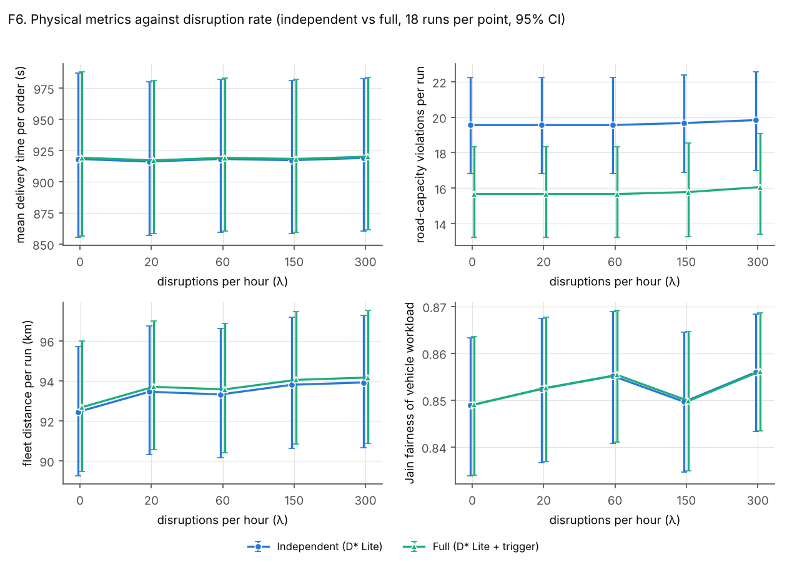
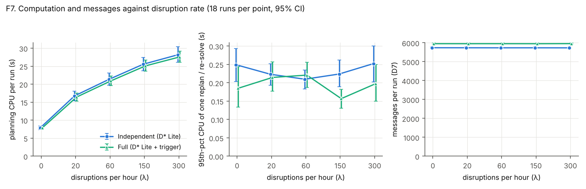
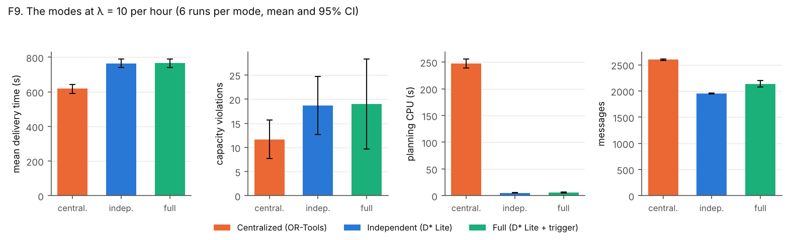

# Report sections written by R8 (evaluation, results, process)

Draft written on 18 Nov 2026 by the owner of R2 with an AI assistant, because the R8 member delivered nothing (see `docs/CONTRIBUTIONS.md`).
Every number in Sections 3 and 4 was copied from files in `reports/r8/` (generated by `python -m src.eval.run_all`), from
`python -m src.eval.pair_signs reports/r8/main`, or, for one road-entry count, from one run log; the interpretation is the assistant's. Section numbers are local to this file; the report editor can renumber them.

## 1. Experimental setup

Three conditions run on the same scenario files and run seeds: `centralized` (OR-Tools re-solves the whole fleet on every event, R4 [13]),
`independent` (each vehicle repairs its own route with D* Lite [1], no negotiation, R7) and `full` (D* Lite plus R5's trigger and Vickrey
auction [3] when a road-capacity conflict is predicted within tau = 600 s). New orders go through contract-net [2] in the two
decentralized modes (D8). `independent` against `full` is the ablation of selective coordination: nothing differs except the trigger.

| Sweep | Runs | Design |
|---|---|---|
| main | 180 | independent and full; 9 medium scenarios (3 layouts x 3 instances); run seeds 101 and 102; disruption rate 0, 20, 60, 150, 300 per hour; 18 matched pairs per rate |
| three_modes | 18 | independent, full, centralized; 3 small scenarios (one per layout); run seeds 101 and 102; 10 disruptions per hour; 6 matched runs per mode |

Metrics are defined in `src/eval/metrics.py` and unit-tested on hand-made logs (23 tests in `tests/test_eval_metrics.py` and
`tests/test_eval_stats.py`). Intervals are 95% percentile bootstraps over runs (10,000 resamples) [12]. Comparisons between modes are
paired by scenario file, run seed and rate. The rate grid is wider than D11's because the plan's rates (up to 20 per hour) moved no
metric in the pilot (`docs/EXPERIMENT_PROTOCOL.md`, Section 5).

## 2. Hypotheses and thresholds (pre-registered)

The claim under test is that selective coordination, started only when a road-capacity conflict is predicted within tau = 600 s (D6), keeps a decentralized fleet close to the quality of full centralized re-optimization at a fraction of the computation and messages, and removes conflicts that independent replanning leaves in place.

The criteria below were written in `docs/EXPERIMENT_PROTOCOL.md` before the main sweep and the three-mode sweep were run. H1 and H2 are the targets of plan Section 7.3 (written 29 Sep 2026) and were not changed. H3 is the plan's third target made concrete (rates 60, 150 and 300 per hour, delivery time and capacity violations) and was split into H3a and H3b after the pilot.

| ID | Criterion | Where it is tested |
|---|---|---|
| H1 | Mean delivery time of `full` is at most 10% above `centralized` | three-mode sweep, 6 matched pairs |
| H2a | Planning CPU of `full` is at most half of `centralized` | three-mode sweep |
| H2b | Messages of `full` are at most half of `centralized` | three-mode sweep |
| H3a | `full` is faster than `independent` with non-overlapping 95% CIs at every rate in {60, 150, 300} | main sweep, 18 matched pairs per rate |
| H3b | `full` has fewer capacity violations than `independent` with non-overlapping 95% CIs at every rate in {60, 150, 300} | main sweep |

Verdicts are produced by `python -m src.eval.thresholds` from the run logs; nobody typed them in.

## 3. Results

All figures were produced by script from the logs; see `reports/r8/RESULTS.md` for every table and `reports/r8/thresholds.md` for the
verdicts. The traffic model (METR-LA) was not available in the environment that ran the sweeps, so travel times are free-flow times plus
the simulator's disruption spikes (`reports/r8/MANIFEST.json`), and the predictor is off.

### 3.1 Pre-registered criteria

| Criterion | Measured | Limit | Result |
|---|---|---|---|
| H1: delivery time of full against centralized | +24.0% (95% CI +17.4% to +31.9%, 6 pairs) | at most +10% | **FAIL** |
| H2a: planning CPU of full against centralized | 2.4% of centralized (CI 2.0% to 2.7%) | at most 50% | **PASS** |
| H2b: messages of full against centralized | 82.2% of centralized (CI 79.7% to 85.0%) | at most 50% | **FAIL** |
| H3a: full faster than independent, non-overlapping CIs, at lambda 60, 150, 300 | full is slower by 0.98 s, 0.99 s, 1.07 s; CIs overlap | full lower at all three | **FAIL** (0 of 3) |
| H3b: full fewer capacity violations than independent, non-overlapping CIs, at lambda 60, 150, 300 | full is lower by 3.9, 3.9, 3.8 violations per run; the unpaired CIs overlap | full lower with non-overlapping CIs at all three | **FAIL** (0 of 3) |

One of five criteria passed. The criteria were fixed before the sweeps ran and were not changed afterwards.

### 3.2 Full against independent (main sweep, Figures F6 and F7)

* **Disruption rate hardly matters on this map.** Mean delivery time is 918 s at 0 per hour and 919 s at 300 per hour for independent (920 s
  for full). At 300 per hour a run has on average 817 disruptions, 348 of them closures, and still 17,997 of 18,000 orders are delivered in
  each mode (three orders fail per mode in total). Planning CPU rises about 3.5 times from 0 to 300 per hour (7.9 s to 28 s for independent),
  so disruptions cost computation, not delivery time.
* **Full is slower than independent by about one second, in every one of the 90 matched runs** (paired difference +0.98 s, CI +0.67 to +1.33
  at lambda 60; +1.07 s at lambda 300). The effect is 0.1% of a 918 s delivery time and is far smaller than the spread between scenarios
  (the unpaired CIs span about 855 to 988 s), which is why H3a fails.
* **Full has fewer capacity violations**: 15.7 against 19.6 per run at lambda 0 to 150, 16.1 against 19.8 at 300. The paired difference
  is -3.9 per run (CI -5.6 to -2.2) at lambda 60. Full has fewer violations in 70 of the 90 matched runs, more in 11 and the same in 9;
  it spends fewer seconds above capacity in 80 of 90 (`python -m src.eval.pair_signs reports/r8/main`). H3b fails only because the pre-registered
  rule compares unpaired intervals, which are wide (violations per run range across scenarios), not paired ones. The paired interval
  excluding zero is a post-hoc observation and does not change the verdict.
* **The gain does not depend on the disruption rate.** The difference is the same at lambda 0 as at 300 (violations 15.7 against 19.6 at
  0 per hour). The trigger acts on conflicts between planned routes produced by the order allocation, and those exist without any disruption.
* **Cost of coordination.** Full replans about 6 more times per run (74.4 against 68.4 at lambda 0, about 9% more) and sends about 215 more messages
  (5,953 against 5,739, all negotiation messages). Its planning CPU is not higher than independent's (it is lower in 46 of 90 matched runs):
  the negotiation overhead is lost in the noise of D* Lite's own cost.
* **Messages are mostly order allocation.** In independent mode every message is an allocation message (contract-net), about 5,700 per
  run; full adds about 215 negotiation messages on top, about 4%.

### 3.3 Three modes (small scenarios, 10 disruptions per hour, Figure F9)

| Mode | Delivery time per order (s) | Capacity violations | Planning CPU (s) | Messages | Jain fairness | Distance (km) |
|---|---|---|---|---|---|---|
| centralized | 619 [591, 644] | 11.7 [7.7, 15.7] | 248 [239, 256] | 2,600 [2,587, 2,613] | 0.822 | 52.9 |
| independent | 764 [740, 789] | 18.7 [12.7, 24.7] | 5.31 [4.60, 5.96] | 1,948 [1,938, 1,957] | 0.748 | 61.6 |
| full | 765 [740, 790] | 19.0 [9.7, 28.3] | 5.85 [4.96, 6.91] | 2,138 [2,074, 2,202] | 0.749 | 61.6 |

All 100 orders per run were delivered in every mode, with an on-time rate of 1. Six runs per mode, so the intervals are wide.
Against independent, full is again about 1 s slower (+1.05 s, CI +0.57 to +1.53) with no detectable difference in violations
(+0.33, CI -3.0 to +3.7), and costs 3.7 more replans, 190 more messages and 0.5 s more CPU per run.

## 4. Discussion

**What the data support.** On these scenarios the two decentralized modes are almost indistinguishable in delivery quality, and the
selective coordination layer buys a modest reduction in capacity violations (about 20% on the medium scenarios) for a small increase in
messages (about 4%) and replans (about 9%). Disruptions, the thing the trigger was designed around, barely changed delivery time, so the
test of "does coordination matter more under stress" had nothing to detect: H3 asks for an effect that grows with disruption, and none appears.

**Where the claim fails.** The central claim, that a decentralized fleet stays within 10% of centralized re-optimization, is not met:
full is 24% slower than centralized on small scenarios. Centralized also has a fairer workload (Jain 0.822 against 0.749, paired CI excludes zero) and fewer violations on average (11.7 against 19.0), though with six runs the violation difference is not conclusive (paired CI -0.7 to +15.3). Full uses 82% as many messages
as centralized, not half. These are measured results and the criteria were not adjusted. The 24% gap is a gap between the two systems as built, not between
centralized and decentralized control in general: centralized drives 14% fewer kilometres (52.9 against 61.6 km) while
serving the same orders, which suggests it assigns and sequences orders better than contract-net insertion does. This experiment does
not isolate that explanation, so it is a hypothesis for follow-up, not a finding.

**H2a passes, but with a caveat.** Centralized planning CPU is about 1.9 s per re-solve times about 130 re-solves per run. The solver runs with a 2 s time limit
(`solver_time_limit_s`, default 2 in `src/allocation/sim_runner.py`; no sweep config overrides it) and its per-re-solve CPU of 1.8 to 2.0 s shows it uses nearly the whole budget each time. The 2.4% ratio is therefore set largely by that budget:
a shorter limit would shrink centralized CPU further. R4's own budget study (`reports/r4/time_limit_study.md`, 4 and 30 orders, static instances) found that 0.5 s reached the same objective as 2 s, so the CPU ratio is probably not a flattering accident of one setting, but we did not test other limits in the sweeps, so the pass says
"decentralized replanning costs far less CPU than a budget-limited re-solve at every event", not that it is 40 times cheaper in general.

**Why the trigger shows so little effect.** Two reasons are visible in the data (the second is only indirect), and one more is a guess. (1) Vehicles rarely meet:
capacity violations are about 16 to 20 per run, against 1,706 road entries in the one run we counted (`medium_uniform_s0`, independent, lambda 0, seed 101), so there is little for negotiation to fix. (2) The trigger fires only for conflicts predicted within tau, and the pilot showed the same small effect before the main sweep, so this is not a one-off. (3) Hypothesis, untested: with
free-flow times and no congestion, conflicts are few and short; the forecaster's congestion pattern might create more, and the sweeps could be rerun on a machine that has
`data/raw/metr-la.h5` to check.

**What was not shown.** There is no evidence here that selective coordination helps under heavy congestion, in larger fleets, or against
centralized control on medium scenarios (centralized was only run on small ones, one rate). The conclusions apply to the simulator, the three
layouts and the two seeds used.

## 5. Course concepts used and where

| Course concept | Where it is used | Code |
|---|---|---|
| Uninformed and informed search: uniform-cost search (Dijkstra) and A* with an admissible, consistent heuristic [4] | Shortest routes on the road graph; the benchmark shows A* expands fewer nodes than Dijkstra | `src/search/dijkstra.py`, `astar.py`, `heuristics.py` |
| Incremental heuristic search (an extension of A*) [1] | Each vehicle repairs its route when a road closes or slows, instead of searching again from scratch | `src/search/dstar_lite.py` |
| Constraint satisfaction: backtracking, MRV ordering, forward checking, AC-3 | Order-to-vehicle feasibility (capacity, time window, shift) | `src/kr/csp.py` |
| Knowledge representation and forward chaining | Production rules (KR-n) decide whether an assignment or detour is allowed | `src/kr/engine.py`, `rules.py` |
| Multi-agent systems: auctions and negotiation [2][3] | Contract-net allocation of new orders (D8); Vickrey (second-price) auction between vehicles whose planned roads conflict | `src/allocation/`, `src/coordination/` |
| Supervised learning on sequences [5] | LSTM traffic forecaster (R6); switched off in every sweep reported here | `src/prediction/` |
| Optimization baseline | OR-Tools routing solver re-solves the whole fleet on each event [13] | `src/allocation/` |

## 6. Data leakage

The traffic forecaster (R6) is trained and evaluated on chronological splits of METR-LA: train 1 Mar to 23 May 2012, validation 23 May to 4 Jun, test 4 Jun to 27 Jun. Rows are never shuffled. Normalization statistics and the free-flow speed of each sensor come from the training rows only. A unit test checks that doubling all congestion after "now" leaves a prediction unchanged (`docs/model_card.md`). Simulation days are drawn from the test period only. The predictor is off in every sweep in this report, so the forecaster cannot influence any result below; R6's ablation is a separate, pilot-scale result.

Order data come from the Amazon last-mile data set [8], whose locations are obfuscated; they are used only to generate scenario files. The run seeds 101 and 102 used in the sweeps were chosen before the sweeps and never used for calibration. Seeds 7 to 9 and 9001 to 9005 were used for calibration only.

## 7. Limitations and risks

1. **Traffic model.** The sweeps in this report were run in a sandbox without `data/raw/metr-la.h5`, so travel times are free-flow times plus the simulator's disruption spikes, not the learned congestion pattern. `reports/r8/MANIFEST.json` records this. The predictor is off in every sweep.
2. **Disruption rates.** The plan's rates (0 to 20 per hour) did not change any metric on this 6,056-road map, so the grid was widened to 300 per hour. At 300 per hour every order was still delivered in the pilot, so even the top of the grid is a mild stress, not a breakdown.
3. **Centralized baseline scope.** Centralized runs only on the small scenarios at one rate (10 per hour), because one run needs about five minutes. Statements comparing `full` with `centralized` therefore cover small fleets only and cannot be extended to medium or large fleets.
4. **Sample size.** Two run seeds per scenario and 9 medium scenarios give 18 matched pairs per rate (6 in the three-mode sweep). The run seed changes only the disruptions, so the spread comes mostly from scenario variety.
5. **Simulation, not reality.** Fleet, demand and disruptions are simulated; the traffic patterns come from Los Angeles highways, and the order locations are obfuscated. No result here is a claim about real Hyderabad deliveries.
6. **Assumed weights.** Priority-weighted delivery time uses weights 3, 2 and 1 for express, standard and economy. That is our assumption (D3 gives none).
7. **Capacity definition.** A violation counts a directed road above capacity 1, the capacity the coordination layer enforces. Violations against the D5 class capacities are also reported.
8. **Same allocation in both decentralized modes.** Contract-net allocation of new orders is identical in `independent` and `full`, so the message difference between them comes only from the negotiation layer.
9. **Process risk.** Evaluation code and the written report were produced on the last day by one team member with an AI assistant, after the evaluation owner delivered nothing (see `docs/CONTRIBUTIONS.md`). Reviewer sign-off and a fresh-clone run by a second person have not happened.
10. **Code version.** Both sweeps ran on commit `d71f103`. PR #50 (a guard that names an unknown vehicle id, plus two timing-test fixes) was merged afterwards; it does not change a normal run, so the results were not rerun.

## 8. Individual contributions

See `docs/CONTRIBUTIONS.md`: one paragraph per member tied to modules and merged PRs, with commit counts per member on `main` at `1b6c27a`.
The R8 work (evaluation code, protocol, sweeps, results, this document, the weekly log) was done on 18 Nov 2026 by the owner of R2 with an AI assistant,
after the R8 member made no commits. Nothing in this folder is backdated; the plan's weekly rhythm is not claimed (`docs/WEEKLY_LOG.md`).

## 9. AI usage

Source: `docs/AI_USAGE_LOG.md`, one line per piece of AI-assisted work, written by the member who did it. At `1b6c27a` the log has 95 dated
entries from 9 Oct to 18 Nov 2026, from 7 names (R1 Siddarth 7, R2 Prudhvi 28, R3 Divesh 17, R4 DarkOrchid19 2, R5 Priyadarshini 6,
R6 Nandan 23, R7 Prabhanjan 12). The R4 count (2) is low next to that member's 10 commits, which may mean the log is incomplete for some members. By tool: Claude 52, Claude Code 32, Gemini 6, Codex 2, Claude chat with Claude Code 3 (the log writes "Claude (chat)" 1 and
"Claude (chat) + Claude Code" 2). The entries for this R8 work are in the log's R8 lines (added with this change).

**What AI was used for.** Writing and testing code from a prompt (most entries: search, simulator, allocation, prediction, evaluation),
explaining concepts for viva preparation, drafting documents, reviewing pull requests, and planning the weekly work. Claude Code wrote files
inside a prompt's scope; commits and pull requests were made by team members.

**How output was checked.** Entries state what was run: pytest counts, comparison against a reference implementation (D* Lite against
networkx A* on thousands of random cases), measurements (benchmarks, timings), or inspection of a rendered figure. For the evaluation
code in this report, the metric functions were tested on hand-made logs with answers worked out by hand, and four wrong definitions were
deliberately introduced and each was caught by a test (`tests/test_eval_metrics.py`); figures were opened and looked at before being kept; and
the draft discussion was checked against the generated tables, which changed several sentences.

**Where AI output was wrong or had to change.** The log records, for example, a wrong prediction that A* would run faster than Dijkstra (A* expanded fewer
nodes, 2.27 times fewer, but was not faster: 0.94 times), a clock-offset bug in a metric that was fixed, a presentation outline that teammates found too thin,
and a pull request that merged into the wrong branch and was repaired with a corrective PR instead of a history rewrite. In the R8 work: a
waiting-time metric over-counted the gap holding a vehicle's last delivery until a new test exposed it; the figure legends overlapped the data and the
log-scaled message axis exaggerated a 4% gap until the figures were inspected; and an early draft of the discussion said a rate limiter was active in the
simulator when `docs/DECISIONS.md` says it is not wired in, which was removed.

**Who decided what.** H1 and H2 come from the plan (written 29 Sep). The concrete rates and metrics of H3 and its split into H3a and H3b were
chosen in this session by the assistant after the pilot, and no team member has reviewed them yet. The reference list was checked entry by entry against the publisher, arXiv or a
library record (Section 10). Commits and pull requests are made by the owner of R2, not by the assistant. Not done: a second person re-running the pipeline from a fresh clone, and
reviewer sign-off on the R8 files.

## 10. References

Every entry below was checked against the publisher, arXiv or a library record while this report was written (18 Nov 2026). The AI-generated first draft of the list was not used as the source.

1. S. Koenig and M. Likhachev. D* Lite. In *Proceedings of the 18th AAAI Conference on Artificial Intelligence (AAAI '02)*, pp. 476-483, 2002.
2. R. G. Smith. The Contract Net Protocol: High-Level Communication and Control in a Distributed Problem Solver. *IEEE Transactions on Computers*, C-29(12):1104-1113, December 1980.
3. W. Vickrey. Counterspeculation, Auctions, and Competitive Sealed Tenders. *The Journal of Finance*, 16(1):8-37, 1961.
4. P. E. Hart, N. J. Nilsson and B. Raphael. A Formal Basis for the Heuristic Determination of Minimum Cost Paths. *IEEE Transactions on Systems Science and Cybernetics*, 4(2):100-107, July 1968. doi:10.1109/TSSC.1968.300136.
5. S. Hochreiter and J. Schmidhuber. Long Short-Term Memory. *Neural Computation*, 9(8):1735-1780, 1997. doi:10.1162/neco.1997.9.8.1735.
6. Y. Li, R. Yu, C. Shahabi and Y. Liu. Diffusion Convolutional Recurrent Neural Network: Data-Driven Traffic Forecasting. In *International Conference on Learning Representations (ICLR)*, 2018. arXiv:1707.01926. (Source of the METR-LA data set.)
7. G. Boeing. OSMnx: New Methods for Acquiring, Constructing, Analyzing, and Visualizing Complex Street Networks. *Computers, Environment and Urban Systems*, 65:126-139, 2017. doi:10.1016/j.compenvurbsys.2017.05.004.
8. D. Merchan, J. Arora, J. Pachon, K. Konduri, M. Winkenbach, S. Parks and J. Noszek. 2021 Amazon Last Mile Routing Research Challenge: Data Set. *Transportation Science*, 2022. doi:10.1287/trsc.2022.1173.
9. V. Pillac, M. Gendreau, C. Gueret and A. L. Medaglia. A review of dynamic vehicle routing problems. *European Journal of Operational Research*, 225(1):1-11, 2013. doi:10.1016/j.ejor.2012.08.015.
10. G. Sharon, R. Stern, A. Felner and N. R. Sturtevant. Conflict-based search for optimal multi-agent pathfinding. *Artificial Intelligence*, 219:40-66, 2015.
11. R. Jain, D.-M. Chiu and W. Hawe. A Quantitative Measure of Fairness and Discrimination for Resource Allocation in Shared Computer Systems. DEC Research Report TR-301, Digital Equipment Corporation, September 1984.
12. B. Efron. Bootstrap Methods: Another Look at the Jackknife. *The Annals of Statistics*, 7(1):1-26, 1979. doi:10.1214/aos/1176344552.
13. L. Perron, V. Furnon and others. OR-Tools (software; routing library used for the centralized baseline). Google. https://developers.google.com/optimization/

## 11. Rubric checklist (status on 18 Nov 2026)

Status words: **done** (exists in the repo and was run or opened), **partial**, **not done**. Items are the plan's evaluation and process
requirements, not the course's marking scheme, which this file does not have.

| Item | Status | Where / note |
|---|---|---|
| Metric definitions written down and tested | done | `src/eval/metrics.py` docstring; 23 tests pass |
| Pre-registered success criteria, fixed before results | done | `docs/EXPERIMENT_PROTOCOL.md`, committed before results are committed |
| Three conditions compared on identical scenarios and seeds | partial | decentralized modes on 9 medium scenarios; centralized only on 3 small ones at one rate |
| Ablation of the coordination trigger | done | independent against full, main sweep |
| Confidence intervals and paired comparisons | done | bootstrap, `src/eval/stats.py`, 10 tests |
| Several seeds | partial | 2 run seeds per scenario |
| Figures and tables produced by script | done | `python -m src.eval.run_all` |
| Honest reporting of missed criteria | done | 4 of 5 criteria failed and are reported as failed |
| Limitations section | done | Section 7 of this file |
| Leakage statement | done | Section 6 of this file |
| Course concepts mapped to code | done | Section 5 of this file |
| Individual contributions | partial | `docs/CONTRIBUTIONS.md`; R8 member's name not filled in |
| AI-usage section from the log | done | Section 9 of this file |
| Verified references | done | Section 10; all 13 entries checked |
| Weekly log | partial | `docs/WEEKLY_LOG.md` reconstructed from the git history, not kept week by week |
| Traffic model in the sweeps | not done | METR-LA file was not available; rerun on a machine that has it |
| Predictor-on experiment | not done | determinism with the predictor on is not verified; R6's pilot ablation is separate |
| Fresh-clone reproduction by a second person | not done | |
| Reviewer sign-off on R8 files | not done | |
| Individual teach-back / viva preparation | not done | |
